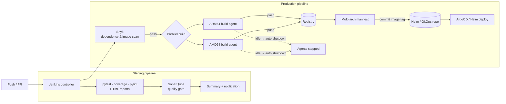

# Secure Multi-Architecture CI/CD

 -lightgrey) 

> **Architecture write-up.** This documents a system I designed and built as a DevOps Engineer at Faclon Labs (Mumbai). The implementation belongs to my employer and is not published; what follows is the design, the moving parts and the outcomes, with internal names and details left out.

When I joined there was no automation: services were tested by hand and
deployed from laptops. I introduced CI/CD from zero and it now covers
**20–30 repositories**. Staging pipelines run unit and integration tests with
coverage and quality reports; production pipelines build the same service
natively for **ARM64 (AWS Graviton)** and **AMD64**, publish one multi-arch
manifest, and commit the new image tag to the Helm repository so the release
itself is a Git commit. SonarQube and Snyk gates sit before anything reaches
production, and build agents shut themselves down when idle. Build plus
deployment went from **25–30 minutes to 5–10**.

## The problem

Builds were manual, single-architecture, and quality and security checks were
steps people ran (or didn't) by hand. Moving compute to Graviton needed images
for two CPU architectures without doubling the work, and nobody could say
which image version a cluster was running.

## Architecture

## Pipeline stages

1. **Checkout and gather** — branch, commit, author and version are collected
   once and threaded through every stage and notification.
2. **Test** — pytest with coverage and HTML reports, pylint, a combined
   summary page per commit.
3. **Quality gate** — SonarQube analysis must pass its thresholds.
4. **Security gate** — Snyk scans dependencies and the built image; known
   critical vulnerabilities fail the build.
5. **Parallel multi-arch build** — native ARM64 and AMD64 agents build the
   same Dockerfile (Docker Buildx); the images are published under one
   multi-arch manifest so a node pulls the right one automatically.
6. **Release as a commit** — the pipeline writes the new tag into the Helm
   values in the GitOps repository; ArgoCD does the rest.
7. **Notify and clean up** — the result, the images built and the report link
   go to the team; build agents stop when the queue is empty, so the fleet
   costs nothing between builds.

## Design points

- **Native builds over emulation**: a real ARM agent builds ARM images in
  minutes; emulated builds took far longer.
- **Gates fail the pipeline, not a dashboard**: findings block the release
  rather than being reported after it.
- **The release is a Git commit**: the tag bump is auditable and revertable,
  and the Helm repository is the single record of what runs where.
- **Standardised image tagging and registry hygiene** across 20+ dockerised
  Python microservices, so every environment knows exactly what it runs.

## Outcomes

- CI/CD introduced from nothing, now on **20–30 repositories**.
- Build + deployment time **25–30 min → 5–10 min**.
- Security and quality checks enforced before production.
- One pipeline per service producing images for both architectures.

## Stack

Jenkins · pytest · pylint · SonarQube · Snyk · Docker Buildx (multi-arch manifests) · ARM64 and AMD64 build agents · Helm · ArgoCD

## My role

Designed and built the pipelines, the test and report stages, the
multi-architecture build strategy, the GitOps hand-off and the agent lifecycle
automation; rolled them out repository by repository.
