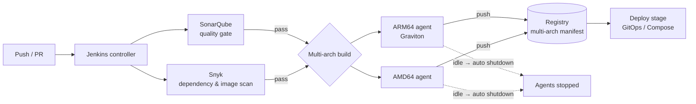

# Secure Multi-Architecture CI/CD

 -lightgrey) 

> **Architecture write-up.** This documents a system I designed and built as a DevOps Engineer at Faclon Labs (Mumbai). The implementation belongs to my employer and is not published; what follows is the design, the moving parts and the outcomes, with internal names and details left out.

Jenkins pipelines that build the same service for **ARM (AWS Graviton)** and
**AMD/x86**, with SonarQube and Snyk gates before anything reaches
production, and build agents that shut themselves down when idle. Build plus
deployment went from **25–30 minutes to 5–10**.

## The problem

Builds were slow, single-architecture, and quality and security checks were
optional steps people ran (or didn't) by hand. Moving compute to Graviton
needed images for two CPU architectures without doubling the work.

## Architecture

## Pipeline stages

1. **Checkout and test** on the controller.
2. **Quality gate** — SonarQube analysis must pass its thresholds.
3. **Security gate** — Snyk scans dependencies and the built image; known
   critical vulnerabilities fail the build.
4. **Parallel multi-arch build** — native ARM64 and AMD64 agents build the
   same Dockerfile; the images are published under one multi-arch manifest so
   a node pulls the right one automatically.
5. **Deploy** — the tag is handed to the deployment layer.
6. **Agent shutdown** — build agents are ephemeral instances that stop when
   the queue is empty, so the fleet costs nothing between builds.

## Design points

- **Native builds over emulation**: a real Graviton agent builds ARM images in
  minutes; emulated builds took far longer.
- **Gates fail the pipeline, not a dashboard**: findings block the release
  rather than being reported after it.
- **Standardised image tagging and registry hygiene** across 20+ dockerised
  Python microservices, so every environment knows exactly what it runs.

## Outcomes

- Build + deployment time **25–30 min → 5–10 min**.
- Security and quality checks enforced before production.
- One pipeline per service producing images for both architectures.

## Stack

Jenkins · SonarQube · Snyk · Docker (multi-arch) · AWS EC2 (Graviton and x86 agents) · container registry

## My role

Designed and built the pipelines, the multi-architecture build strategy and
the agent lifecycle automation.
